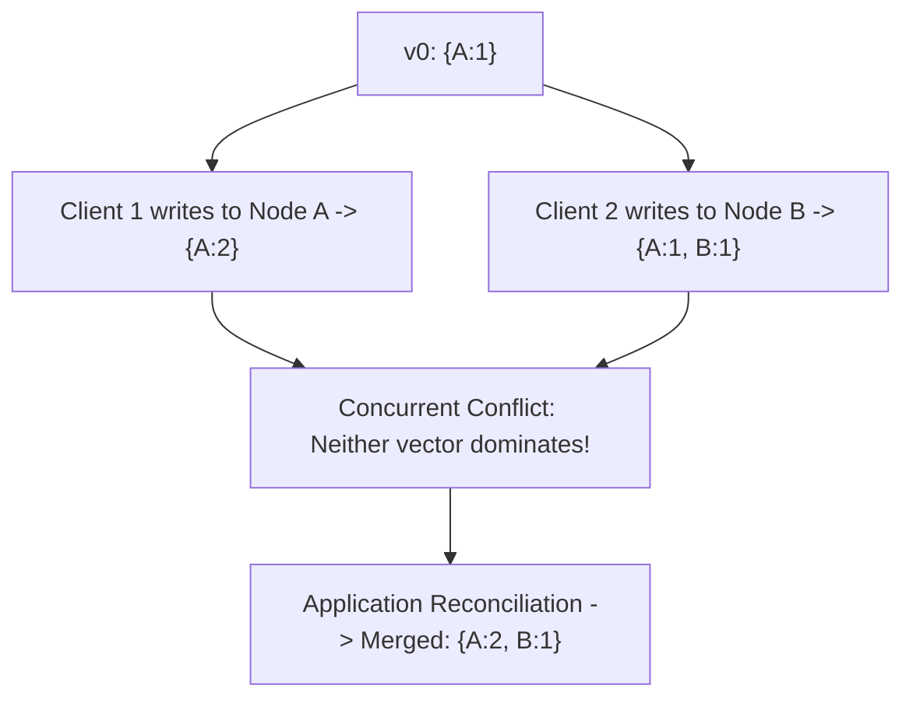

# Distributed Data: Vector Clocks vs Version Vectors

In distributed key-value stores (e.g. Amazon Dynamo, Riak), version vectors track causality between concurrent object updates across replicas.

---

## 1. Causality Rules
Given two version vectors $V_1$ and $V_2$:
- $V_1 \le V_2$ if $\forall k, V_1[k] \le V_2[k]$
- $V_1$ and $V_2$ are concurrent if $\exists i, j$ such that $V_1[i] > V_2[i]$ and $V_1[j] < V_2[j]$.
