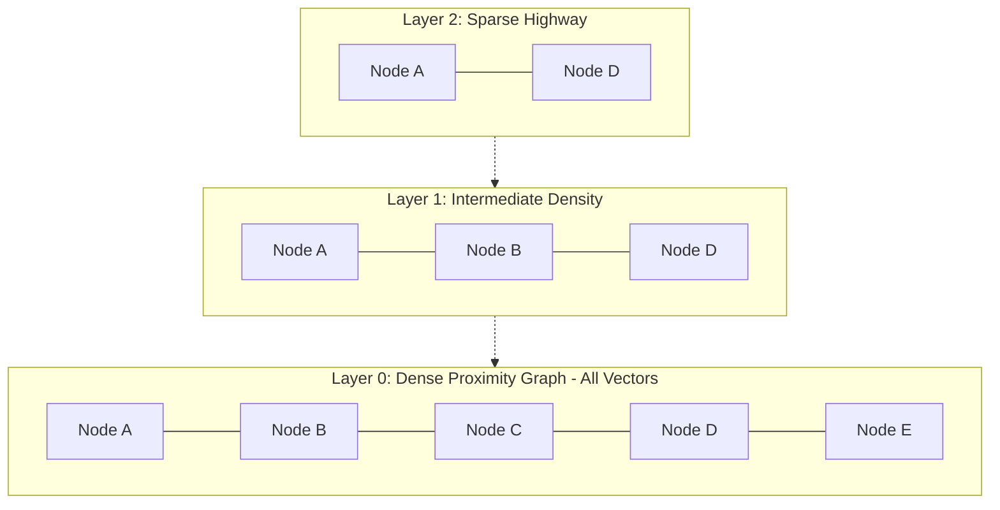

# HNSW: Hierarchical Navigable Small World Vector Indexing

Hierarchical Navigable Small World (HNSW) organizes high-dimensional embeddings into multi-layer proximity graphs with logarithmic search complexity, inspired by skip-lists.

---

## 1. Parameters & Tradeoffs

1. **$M$ (Max Edges per Node):** Controls memory footprint and connectivity graph degree. Typical range: 16 to 64. Higher values boost recall on clustering datasets.
2. **$efSearch$ (Search Exploration Factor):** Size of the dynamic candidate priority queue evaluated at query time. Tradeoff: higher recall vs increased query latency.
3. **$efConstruction$:** Search horizon size during node insertion. Governs index build speed and quality.
