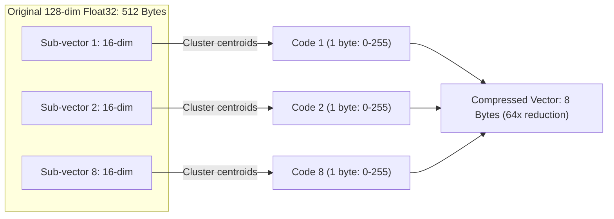

# IVF-PQ: Inverted File with Product Quantization

Product Quantization compresses vector embeddings into compact byte codes, enabling billion-scale similarity search within RAM limits.

---

## 1. Two-Level Indexing Pipeline

1. **Inverted File (IVF):** The vector space is partitioned into $k$ Voronoi cells via $k$-means. At query time, only the closest $n_{probe}$ inverted lists are evaluated.
2. **Asymmetric Distance Computation (ADC):** Computes distances between the uncompressed query vector and compressed dataset byte codes using pre-calculated lookup tables (LUT), avoiding full vector decompression.
