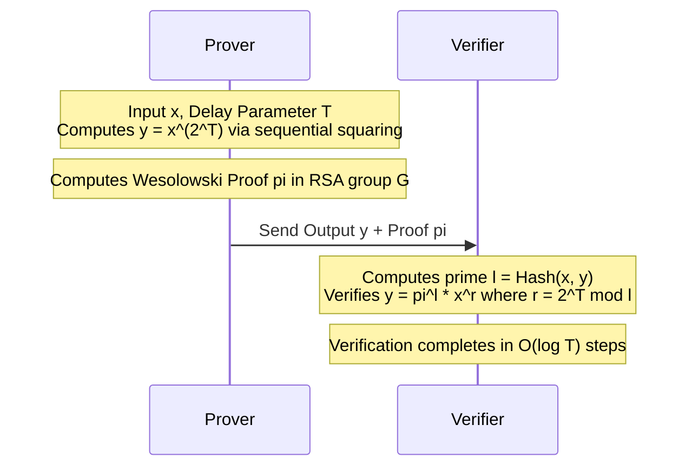

# Cryptography: Verifiable Delay Functions (VDF: Wesolowski)

Verifiable Delay Functions require a non-parallelizable sequential time duration $T$ to evaluate, while producing an output that can be verified by external nodes in sub-millisecond logarithmic time.

---

## 1. Structural Mathematics

* **Sequential Evaluation:** Prover computes $y = x^{2^T} \pmod N$ in an RSA group of unknown order without factorization shortcut.
* **Wesolowski Proof Construction:**
  - Let $l = 	ext{PrimeHash}(x, y)$.
  - Prover computes quotient $q = \lfloor 2^T / l 
floor$ and remainder $r = 2^T \pmod l$.
  - The proof is group element $\pi = x^q \pmod N$.
* **Verification Equation:** Verifier computes $r = 2^T \pmod l$ efficiently using modular exponentiation and verifies:

$$\pi^l \cdot x^r \equiv y \pmod N$$
