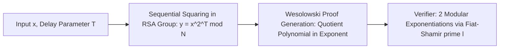

# Verifiable Delay Functions (VDF)

A Verifiable Delay Function requires a prescribed number of sequential steps $T$ to compute, even with massive parallelism, but produces a short proof verifiable in $O(\log T)$ or $O(1)$ time.

---

## 1. Wesolowski Protocol Mechanics

### Evaluation Phase (Slow)
In an unknown order group (RSA group $N = p \cdot q$ where factorisation is unknown):
$$y = x^{2^T} \pmod N$$
Requires $T$ sequential squarings; cannot be parallelized.

### Proof Generation Phase
1. Hashes $(x, y)$ to derive prime $l = H_{	ext{prime}}(x, y)$.
2. Performs integer division in exponent:
   $$2^T = q \cdot l + r, \quad 0 \le r < l$$
3. Computes proof:
   $$\pi = x^q \pmod N$$

### Verification Phase (Fast)
1. Verifier computes $r = 2^T mod l$.
2. Checks equality using single multi-exponentiation:
   $$\pi^l \cdot x^r \equiv y \pmod N$$
