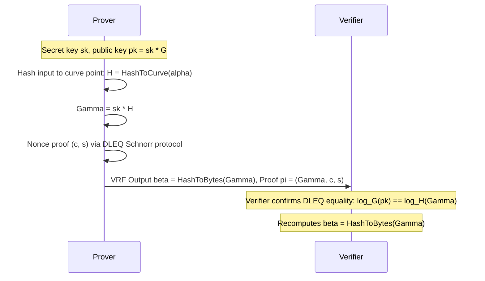

# Verifiable Random Functions (VRF)

A Verifiable Random Function produces a deterministic pseudorandom output along with a cryptographic proof that the output was computed correctly using the owner's private key.

---

## 1. Core Cryptographic Invariants

Given input $lpha$, secret key $SK$, and public key $PK$:
1. **Uniqueness:** No adversary can find $(PK, lpha)$ and two proofs $\pi_1 
eq \pi_2$ yielding distinct valid outputs $eta_1 
eq eta_2$.
2. **Pseudorandomness:** Without the proof $\pi$, the output $eta = 	ext{VRF\_Hash}(SK, lpha)$ is indistinguishable from uniform random bytes to any polynomial-time observer.
