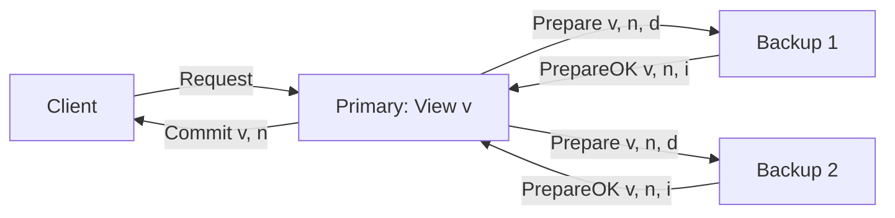

# Consensus Architecture: Viewstamped Replication Revisited

Viewstamped Replication (VRR), introduced by Oki and Liskov, predates Paxos and Raft, providing clean primary-backup consensus based on explicitly numbered views.

---

## 1. Primary Components
- **View-Number:** Monotonic identifier of the current primary tenure.
- **Op-Number:** Sequential order of operations in the log.
- **Commit-Number:** Highest op-number known to be replicated on a quorum.
