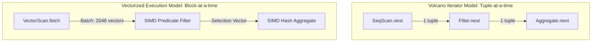

# Query Engines: Volcano Iterator vs Vectorized Execution

Modern SQL analytical engines replace the classic tuple-at-a-time Volcano Iterator model with vectorized block-oriented processing to exploit CPU L1 data cache and SIMD execution units.

---

## 1. Performance Differences

| Dimension | Volcano Iterator Model | Vectorized Engine (DuckDB/ClickHouse) |
|---|---|---|
| **Call Overhead** | High: Dynamic virtual dispatch per tuple | Low: Loop iteration over columnar arrays |
| **CPU Cache Efficiency** | Poor: Interleaved row attributes evict L1 | High: Dense columnar vectors fit L1/L2 caches |
| **SIMD Exploitation** | None | Native: AVX-512 / ARM Neon vector instructions |
| **Branch Mispredictions**| Frequent inside per-tuple predicates | Minimal across batched loop kernels |
