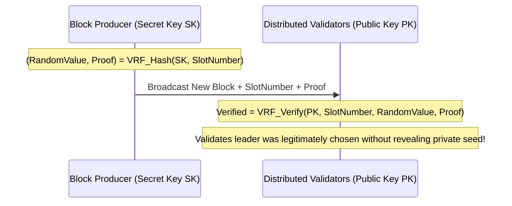

# Cryptographic Consensus: Verifiable Random Functions (VRF)

A Verifiable Random Function (VRF) generates a pseudorandom number along with a cryptographic proof that only the private key holder could have generated it for a specific input.

---

## 1. Key Invariant
Prevents grinding attacks: The block producer cannot manipulate or predict future lottery outcomes without changing its fixed public key.
