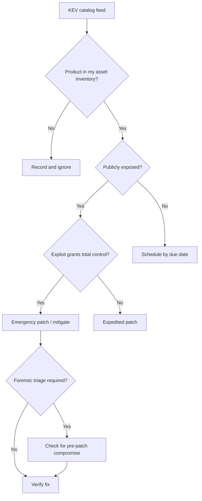

# Vulnerability Management: Risk-Based Prioritization with CISA KEV & BOD 26-04

CVSS measures theoretical severity. The **CISA Known Exploited Vulnerabilities (KEV) catalog** records vulnerabilities with evidence of *active exploitation*. **Binding Operational Directive 26-04** ("Prioritizing Security Updates Based on Risk") requires US Federal Civilian Executive Branch agencies to prioritize KEV entries, especially on publicly exposed assets where exploitation gives total control, and to check whether the system was compromised **before** the patch was applied. CISA encourages all organizations to adopt the same approach.

---

## 1. Triage Flow

---

## 2. KEV Additions, November 2026 (selection)

| Date added | CVE | Product | Weakness | Due date* |
| :--- | :--- | :--- | :--- | :--- |
| 2026-11-18 | CVE-2026-40217 | BerriAI LiteLLM | Unprotected alternate channel | per KEV |
| 2026-11-18 | CVE-2026-90436 | Apache Axis | Unsafe reflection | per KEV |
| 2026-11-20 | CVE-2026-129448 | Apache Roller | Deserialization of untrusted data | 2026-11-23 |
| 2026-11-20 | CVE-2026-76466 | Cisco Expressway | Hard-coded credentials | 2026-11-23 |
| 2026-11-20 | CVE-2026-123890 | VMware vCenter | Authentication bypass via alternate path | 2026-11-23 |
| 2026-11-20 | CVE-2025-42884 | SAP NetWeaver | Special-element neutralization (JNDI) | 2026-11-23 |
| 2026-11-23 | CVE-2026-133968 | Project MONAI MONAI Label | Path traversal | per KEV |
| 2026-11-23 | CVE-2026-134624 | N-able Mail Assure | SSRF | per KEV |
| 2026-11-24 | CVE-2026-132165 | Drupal Core | Remote code execution | 2026-11-27 |
| 2026-11-25 | CVE-2026-133323 | Mitel MiCollab (AWV) | OS command injection | 2026-11-28 |
| 2026-11-25 | CVE-2026-103406 | HPE Juniper Session Smart Router/Conductor | OS command injection (salt minion ID) | 2026-11-28 |

**Deep dives:** [Roller/SAP deserialization-JNDI](deserialization-jndi-injection-roller-sap-netweaver.md), [Cisco Expressway](hardcoded-credentials-cluster-trust-cisco-expressway.md), [Mitel MiCollab AWV chain](mitel-micollab-awv-vulnerability-chain-zero-day.md), [Drupal Fail2Install](drupal-installer-reinstall-fail-open-fail2install.md), [vCenter + BeyondTrust](vcenter-srp-auth-bypass-beyondtrust-armory-castle-chain.md).

\*Federal due dates; the KEV entry is authoritative. The 2026-11-25 batch also includes four further Mitel MiCollab CVEs and three Danfoss AK-SM 800A CVEs, plus Vates Xen Orchestra CVE-2026-133469.

Observation: a 3-day federal deadline now applies to the highest-risk entries, so private teams should assume the same exploitation window.

---

## 3. Recurring Weakness Classes

| Class | November 2026 examples | Engineering control |
| :--- | :--- | :--- |
| OS command injection | Mitel MiCollab, HPE Juniper SSR | Never build shell strings from input; use argument arrays |
| Deserialization / unsafe reflection | Roller, Axis, Idunno AntiCsrf | Type allow-lists, no pre-auth deserialization |
| Auth bypass / weak auth | vCenter, MiCollab | Single enforced auth gate, fail closed |
| Hard-coded credentials | Cisco Expressway | Per-device secrets, rotation |
| Path traversal / SSRF | MONAI Label, Mail Assure, Danfoss | Canonicalize paths, egress allow-lists |

---

## 4. Practical Implementation

* **Automate ingestion.** Poll the KEV JSON feed and diff against your SBOM/asset inventory.
* **Rank by three inputs:** KEV membership, internet exposure, and post-exploit impact (total control vs. limited).
* **Do not trust CVSS alone.** CVE-2025-42884 scores 6.5 but chains into RCE and is exploited.
* **Mitigate while patching.** Remove public exposure, add WAF rules, restrict management interfaces.
* **Compromise assessment.** When "forensic triage required" is marked, review logs back to before the patch date.
* **Track exceptions** with an owner and an expiry date.

---

## References

* CISA KEV catalog and alerts of 2026-11-18, 11-20, 11-23, 11-24, 11-25
* BOD 26-04: Prioritizing Security Updates Based on Risk
