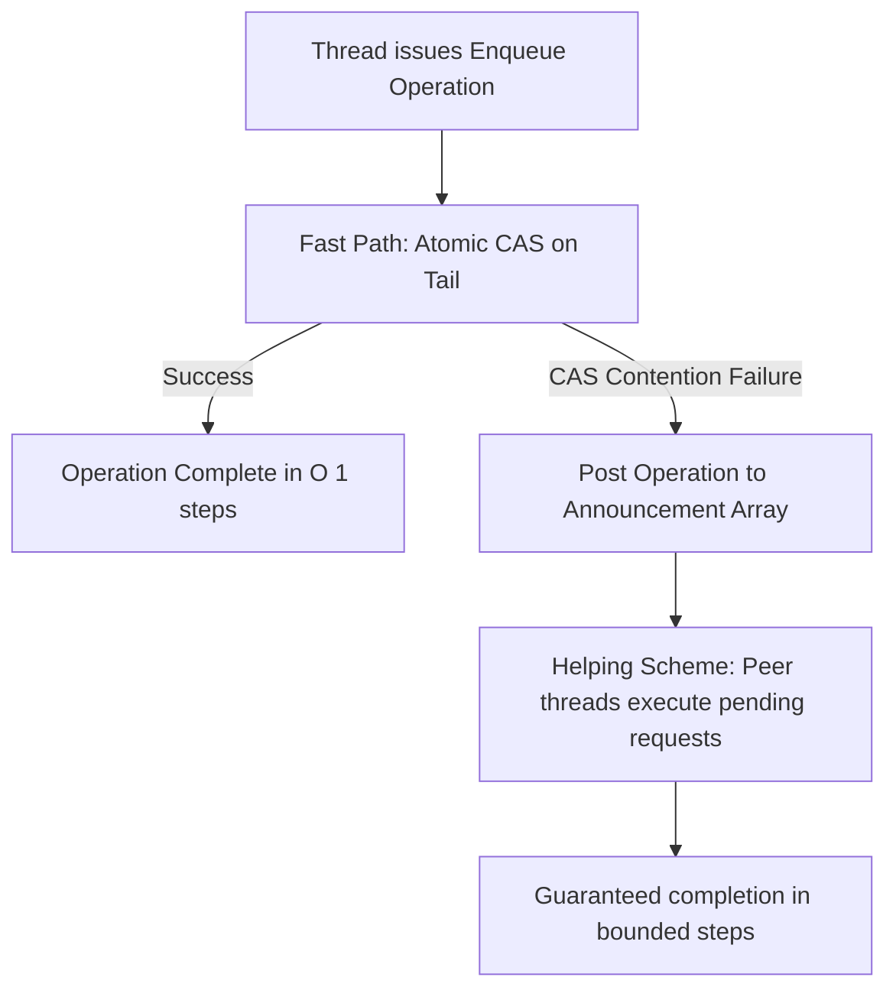

# Wait-Free Queue Architecture & Bounded Progress Guarantees

A wait-free data structure guarantees that every active thread completes its operation in a bounded number of execution steps, regardless of the relative speed or preemption of other concurrent threads.

---

## 1. Concurrency Hierarchy

$$	ext{Blocking} \subset 	ext{Obstruction-Free} \subset 	ext{Lock-Free} \subset 	ext{Wait-Free}$$

* **Lock-Free:** At least one thread makes forward progress in finite steps.
* **Wait-Free:** *Every* thread makes forward progress in bounded steps.
