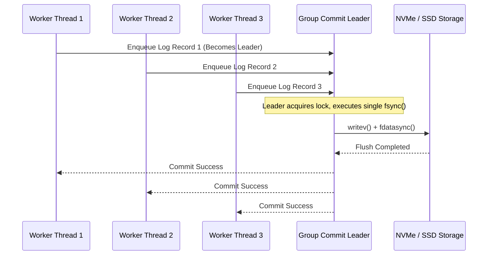

# Database Internals: WAL Group Commit and fsync Pipelining

A single mechanical disk or SSD can only execute a limited number of `fsync()` operations per second. Group commit batches multiple concurrent transactions into a single flush.

---

## 1. Performance Impact
Without group commit: Throughput capped at disk IOPS ($IOPS = 1 / \text{latency}$).  
With group commit: Throughput scales with queue concurrency, amortizing latency across $N$ workers.
