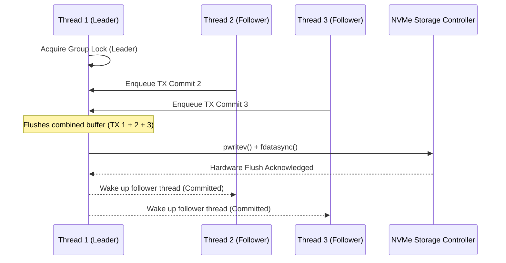

# WAL: Group Commit & fsync Pipelining Architecture

Database engines batch concurrent transaction flush requests into a single hardware `fsync` call to maximize NVMe IOPS efficiency and eliminate write stall bottlenecks.

---

## 1. Optimization Mechanics

* **Slot Ring Queues:** Non-blocking atomic ring buffers buffer commit tokens. The first arriving worker thread becomes the leader; subsequent threads join the pending sync batch.
* **Delayed Sync Tuning:** Configurable thresholds (`commit_delay`, `commit_siblings`) pause the leader for several microseconds to batch additional concurrent transactions into one barrier.
