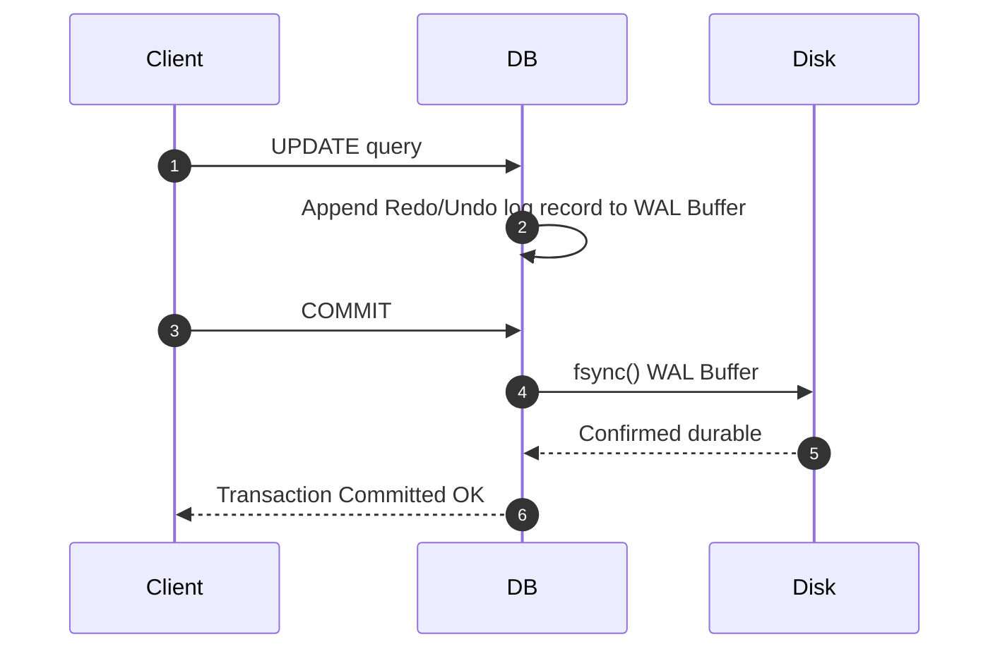

# Write-Ahead Logging (WAL) & ARIES Recovery Protocol

Guarantees Atomicity and Durability (ACID) by mandating log persistence prior to dirty buffer eviction.

---

## 1. ARIES 3-Phase Recovery

1. **Analysis**: Reconstructs dirty pages in memory and active transactions at failure point.
2. **Redo**: Repeats history from earliest `RecLSN` forward to reconstruct exact pre-crash state.
3. **Undo**: Rolls back uncommitted transactions using Compensation Log Records (CLRs).
