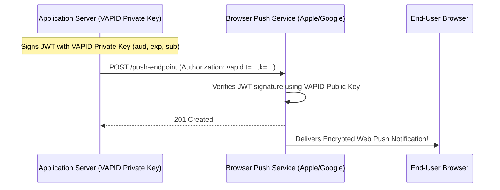

# Web Standards: Voluntary Application Server Identification (VAPID)

RFC 8292 VAPID allows application servers to authenticate directly with push services (FCM, Apple Push, Mozilla Push) without vendor-specific accounts.

---

## 1. Encryption Invariant
Push payloads are encrypted end-to-end using AES-128-GCM with ECDH keys generated in the browser; the intermediate push service cannot inspect payload contents.
