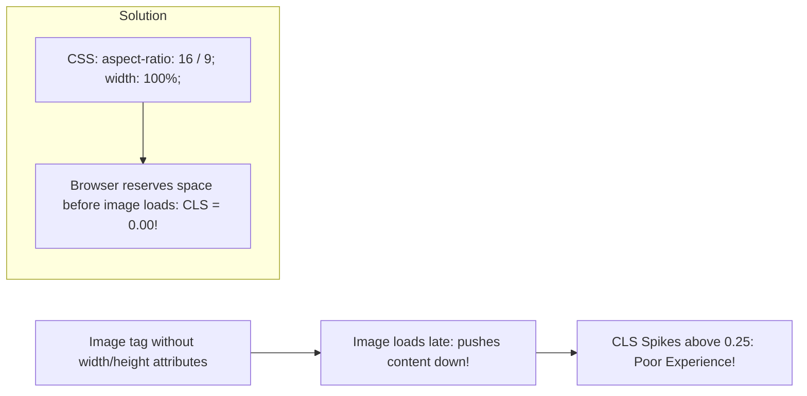

# Web Performance: Cumulative Layout Shift (CLS) Prevention

CLS measures unexpected layout movements during page lifecycle, calculated as $\text{Impact Fraction} \times \text{Distance Fraction}$.

---

## 1. Target
Google Core Web Vitals benchmark requires $CLS \le 0.1$ at the 75th percentile of page visits.
