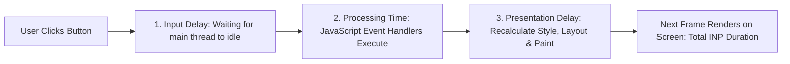

# Web Performance: Core Web Vitals INP Optimization Architecture

Interaction to Next Paint (INP) measures the longest latency between user interaction (click, keypress, tap) and the next frame update.

---

## 1. Thresholds
- **Good:** $\le 200\text{ms}$
- **Needs Improvement:** $200\text{ms} - 500\text{ms}$
- **Poor:** $> 500\text{ms}$
