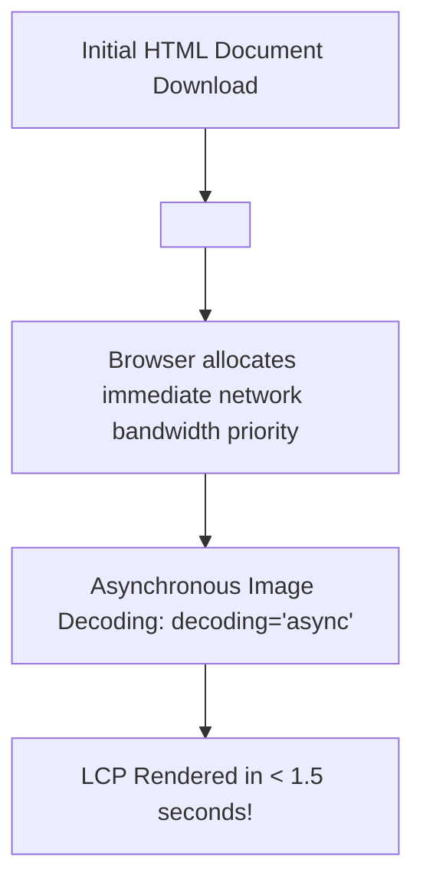

# Web Performance: Largest Contentful Paint (LCP) Pipeline

LCP measures when the largest visual content element (hero image, heading text block) is rendered in the viewport.

---

## 1. Anti-Patterns
- Lazy-loading above-the-fold hero images (`loading="lazy"`) degrades LCP by delaying discovery until layout pass.
