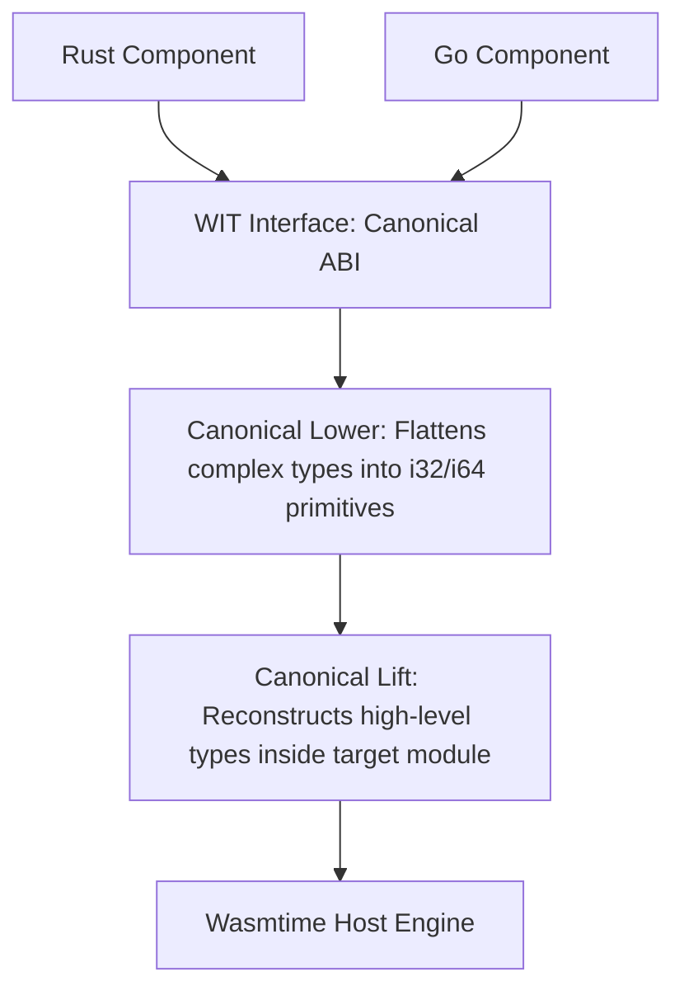

# Wasm Evolution: WebAssembly Component Model and Canonical ABI

The Wasm Component Model enables polyglot composability: combining modules written in Rust, Go, Python, and C++ into a single sandbox using WIT (Wasm Interface Type) definitions.

---

## 1. Memory Isolation
Components cannot access each other's linear memory directly; interaction occurs strictly across typed boundary functions governed by the Canonical ABI.
