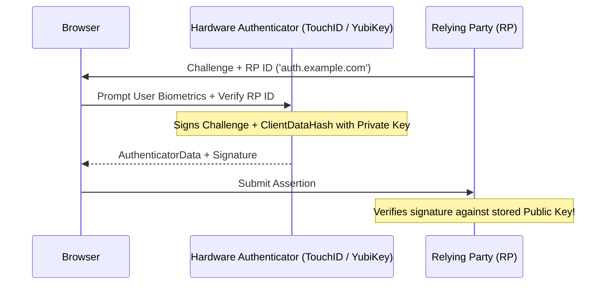

# Passwordless Security: WebAuthn / FIDO2 Passkey Cryptography

WebAuthn replaces passwords with asymmetric cryptographic keypairs generated inside hardware security keys or device secure enclaves (TouchID, FaceID).

---

## 1. Phishing Immunity
The client platform validates that the origin matches the RP ID. Even if a user visits a convincing phishing site (`evil-login.com`), the authenticator will sign for `evil-login.com`, which the real server will reject immediately.
