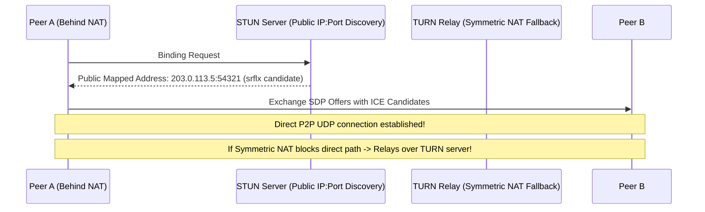

# Real-Time Communication: Interactive Connectivity Establishment (ICE)

WebRTC establishes peer-to-peer audio/video streaming across firewalls and symmetric NATs using the ICE framework.

---

## 1. Candidate Priority
ICE attempts candidates in strict cost order: Host (local LAN) $\rightarrow$ Server Reflexive (STUN) $\rightarrow$ Relay (TURN).
