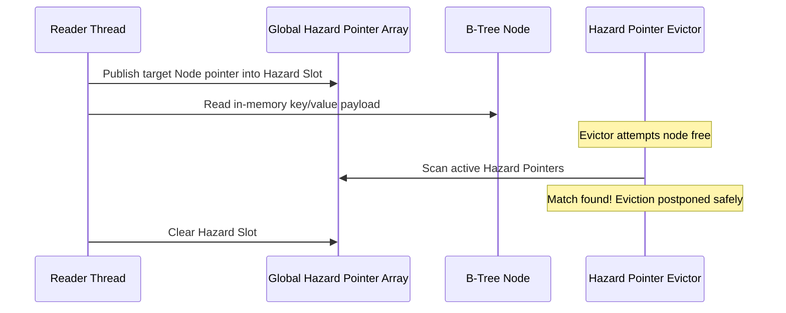

# WiredTiger B-Tree Hazard Pointers & Lock-Free Traversal

WiredTiger (MongoDB's storage engine) achieves high concurrent read throughput by protecting in-memory B-Tree nodes with hazard pointers, preventing memory reclamation during lock-free traversal.

---

## 1. Safe Memory Reclamation Guarantee

A retired B-Tree node is only freed or unmapped when a scan of all thread hazard slots confirms zero active references to the pointer.
