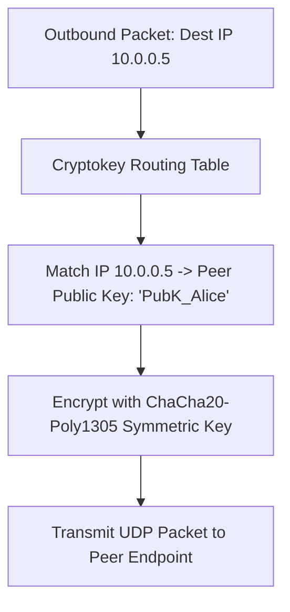

# Network Tunneling: WireGuard Cryptokey Routing Protocol

WireGuard replaces complex IPsec/IKEv2 configurations with Cryptokey Routing: mapping public encryption keys directly to allowed IP addresses.

---

## 1. 1-RTT Noise Protocol Handshake
- Uses Noise IK handshake pattern (`Noise_IKpsk2_25519_ChaChaPoly_BLAKE2s`).
- If no data is transmitted, the tunnel is completely silent (transmits zero packets, making endpoints invisible to port scans).
