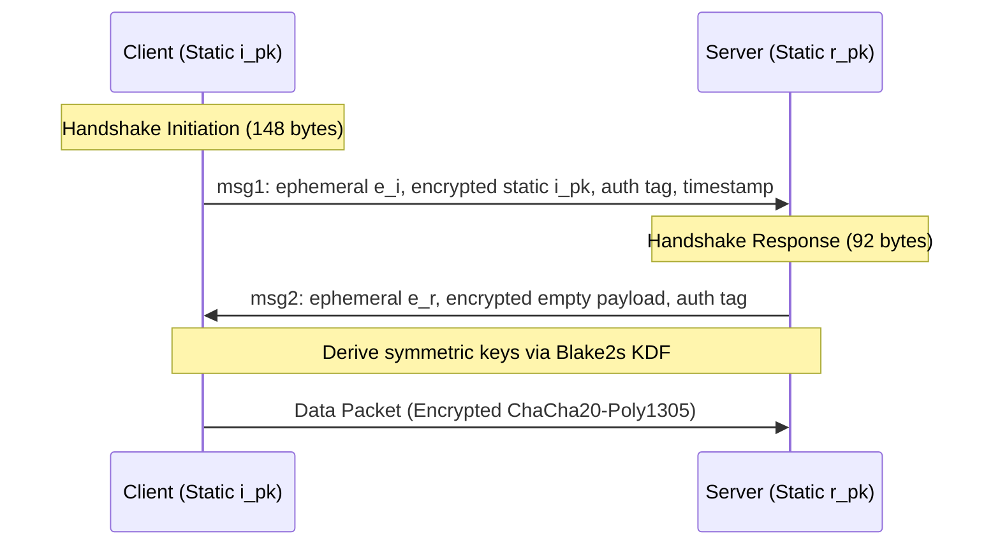

# WireGuard Cryptokey Routing & Protocol Architecture

WireGuard instantiates the `Noise_IKpsk2_25519_ChaChaPoly_BLAKE2s` protocol framework, binding public keys directly to permitted IP tunnels inside the Linux network stack.

---

## 1. Cryptokey Routing Table

Instead of binding VPN sessions to stateful virtual interfaces:
* The kernel matches destination IP against a routing table: `10.0.0.2/32 -> Peer Public Key PubK_A`.
* Encrypts packet using symmetric key derived from `PubK_A`.
* Enforces firewall rules strictly prior to packet ingress into the host network stack.
