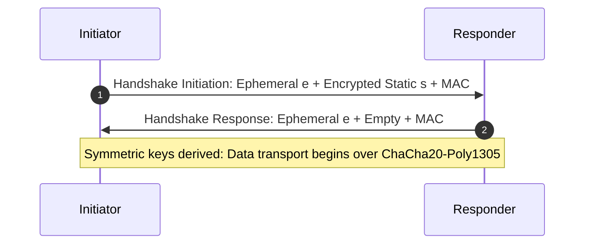

# WireGuard Cryptography: Noise_IKpsk2 Handshake

WireGuard implements the Noise Protocol Framework (`Noise_IKpsk2`) with static 1-RTT handshake authentication.

---

## 1. Cryptographic Primitives

- **Key Exchange**: Curve25519 ECDH.
- **Authenticated Encryption**: ChaCha20-Poly1305 AEAD.
- **Hashing & KDF**: BLAKE2s.
