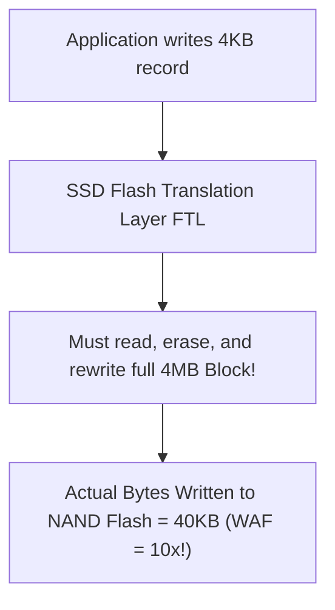

# Storage Hardware: Write Amplification Factor (WAF) and SSD Endurance

SSDs cannot overwrite flash memory in-place; they write in pages (4KB-16KB) and erase in blocks (2MB-8MB), causing internal garbage collection overhead.

---

## 1. WAF Formula
$$\text{WAF} = \frac{\text{Bytes Written to NAND Flash}}{\text{Bytes Written by Host Application}}$$
Sequential writes (LSM WAL) achieve WAF $\approx 1.0$, while random in-place updates can spike WAF above $15.0$, rapidly burning out SSD drive write endurance.
