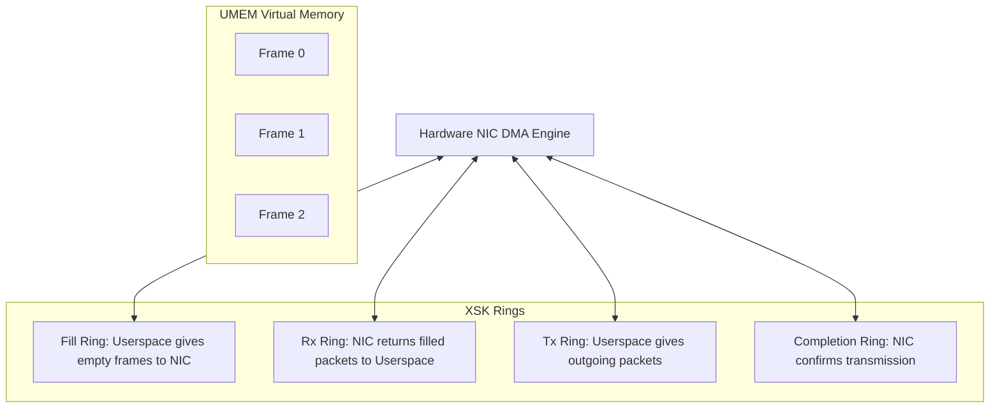

# AF_XDP (XSK) Zero-Copy UMEM Frame Architecture

AF_XDP bypasses the Linux network stack by mapping registered physical RAM buffers (UMEM) directly into user space, allowing direct memory exchange between hardware DMA rings and software queues.

---

## 1. Zero-Copy Setup Flags

* `XDP_ZERO_COPY`: Enforces true zero-copy hardware DMA direct to UMEM.
* `XDP_USE_NEED_WAKEUP`: Avoids redundant `poll()` / `sendto()` syscalls when driver queues are active.
