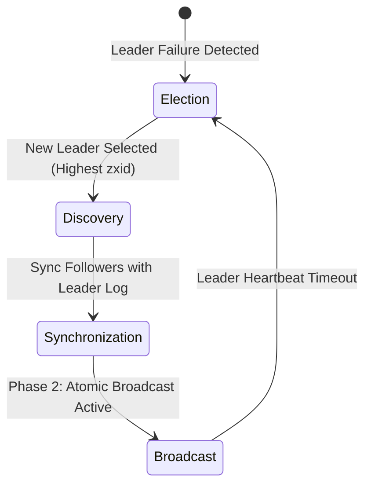

# ZooKeeper: ZAB Protocol Leader Election & Atomic Broadcast

ZooKeeper Atomic Broadcast (ZAB) is a crash-fault-tolerant consensus protocol designed specifically for primary-backup systems.

---

## 1. The ZXID Structure
The 64-bit `zxid` consists of:
- **High 32 bits:** Epoch number (increments with each new leader election).
- **Low 32 bits:** Monotonic transaction counter within that epoch.
