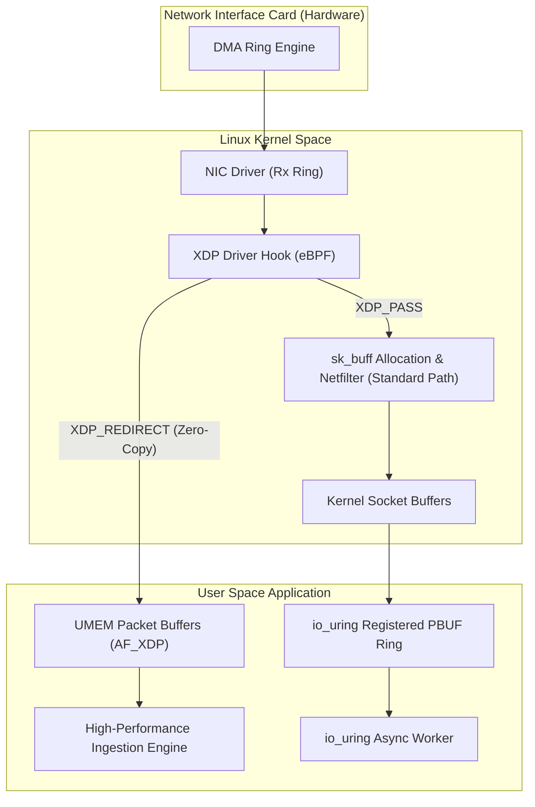

# High-Performance Networking: io_uring vs eBPF AF_XDP Zero-Copy Ingestion Architecture

Modern multi-gigabit (25GbE / 100GbE / 400GbE) line-rate networking requires bypassing traditional Linux socket overhead (`sk_buff` allocation, multiple context switches, and page-cache copying). Two primary Linux kernel facilities achieve microsecond and sub-microsecond zero-copy packet ingestion: **eBPF AF_XDP** and **io_uring**.

---

## 1. Architectural Overview & Packet Paths

---

## 2. Structural & Mechanism Comparison

| Architectural Dimension | eBPF AF_XDP (XSK) | Linux io_uring (PBUF Ring) |
| :--- | :--- | :--- |
| **Primary Layer** | L2/L3 Driver Hook (XDP) | L4 POSIX Socket Interface (`recvmsg`, `readv`) |
| **Kernel Bypass Degree** | Near-complete (Bypasses `sk_buff`, Netfilter, TCP/IP stack) | Partial (Preserves kernel network stack; bypasses context switches) |
| **Memory Architecture** | Pre-allocated UMEM ring (Fill, Rx, Tx, Completion rings) | Circular Submission Queue (SQ) & Completion Queue (CQ) with registered buffer rings |
| **Zero-Copy Mechanism** | NIC DMA directly into userspace-pinned UMEM memory chunks | `IORING_REGISTER_PBUF_RING` + Multishot receive |
| **Driver Support Requirement** | Requires native driver zero-copy support (Intel `ice`, `i40e`, Mellanox `mlx5`) | Standard Linux network drivers (Kernel 5.19+) |
| **Protocols Supported** | Raw Ethernet, IP, custom L2/L3 frame parsing in userspace | Full TCP/IP, UDP, TLS (Kernel kTLS or OpenSSL userspace) |
| **Typical Latency Profile** | 200ns – 800ns | 1.2µs – 3.5µs |
| **Throughput (Single Core)** | ~25–35 Million Packets Per Second (Mpps) | ~8–14 Million Packets Per Second (Mpps) |

---

## 3. Ring Buffer Mechanics

### A. AF_XDP Four-Ring Architecture
1. **Fill Ring (Userspace $\to$ Kernel)**: Pointers to empty UMEM chunks ready for incoming packet DMA.
2. **Rx Ring (Kernel $\to$ Userspace)**: Descriptors of packets received with length, offset, and timestamp.
3. **Tx Ring (Userspace $\to$ Kernel)**: Descriptors of outbound packets to be queued to the NIC wire.
4. **Completion Ring (Kernel $\to$ Userspace)**: Pointers to UMEM chunks whose transmission finished and can be recycled.

### B. io_uring Submission & Completion Architecture
1. **Submission Queue (SQ)**: Userspace pushes `io_uring_sqe` requests (e.g. `IORING_OP_RECV_MULTISHOT`).
2. **Completion Queue (CQ)**: Kernel emits `io_uring_cqe` tokens pointing to populated buffers from the registered buffer ring.
3. **SQPOLL Mode**: Dedicated kernel thread (`IORING_SETUP_SQPOLL`) continuously polls SQ without requiring `enter()` syscalls.

---

## 4. Selection Matrix for Production Systems

* **Choose eBPF AF_XDP When:**
  * Ingesting raw market data multicast feeds (ITCH/OUCH/FAST) in High-Frequency Trading.
  * Building Layer 4 software load balancers (analogous to Cloudflare Katran or Cilium XDP).
  * Analyzing line-rate network telemetry or intrusion detection (IDS/IPS) at 40G/100G wire speed.
* **Choose io_uring When:**
  * Serving stateful TCP/HTTP/WebSocket connections with TLS termination where full TCP reliability is mandatory.
  * Building unified I/O architectures that mix disk storage (`NVMe`) and network sockets in a single event loop.
  * Running in constrained cloud environments where custom NIC drivers or root network capabilities are restricted.
