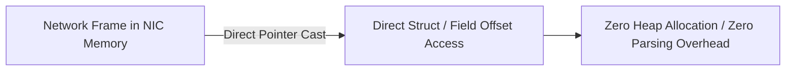

# Zero-Copy Serialization: FlatBuffers & Cap'n Proto

Traditional serialization formats (JSON, Protobuf) require parsing into intermediate objects. Zero-copy formats structure data in memory to match on-wire binary layout.



---

## 1. Serialization Benchmark Comparison

| Format | Parsing Time (Nanoseconds) | Allocation Count | Wire Overhead |
|---|---|---|---|
| **JSON** | 1,200 ns – 4,500 ns | 12–40 allocations | Large (Textual) |
| **Protobuf v3** | 150 ns – 400 ns | 1–4 allocations | Small (Varint-packed) |
| **FlatBuffers** | **0 ns** (In-place traversal) | **0 allocations** | Compact (vtable offsets) |
| **Cap'n Proto** | **0 ns** (Pointer arithmetic) | **0 allocations** | Aligned (64-bit words) |

---

## 2. In-Place Field Access Pattern

```cpp
#include <cstdint>

struct MarketUpdateMessage {
    uint32_t message_size;
    uint16_t message_type;
    uint64_t timestamp_ns;
    uint32_t instrument_id;
    int64_t best_bid;
    int64_t best_ask;
};

// Access directly from network buffer without deserialization
inline const MarketUpdateMessage* parse_market_update(const uint8_t* wire_buffer) {
    return reinterpret_cast<const MarketUpdateMessage*>(wire_buffer);
}
```
