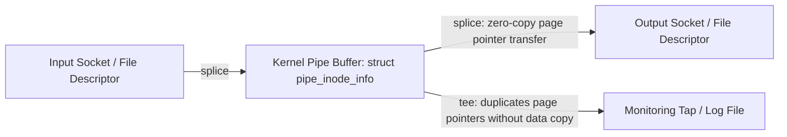

# Linux I/O: Zero-Copy with splice, vmsplice, and tee

The Linux kernel pipe subsystem provides zero-copy page transfer primitives (`splice`, `vmsplice`, `tee`), moving data between file descriptors by transferring memory page references.

---

## 1. System Call Roles

* **`splice()`:** Moves data between an arbitrary file descriptor and a pipe without copying to user-space memory buffers.
* **`tee()`:** Duplicates up to $N$ bytes between two pipes without consuming data from the source pipe buffer.
* **`vmsplice()`:** Maps user-space memory pages directly into a kernel pipe buffer.
