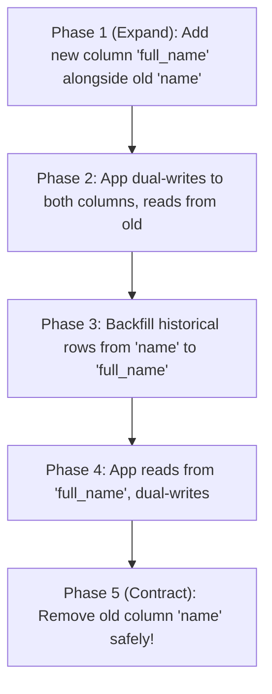

# Database Reliability: Zero-Downtime Expand and Contract Pattern

Renaming or dropping database columns in production without service downtime requires phased multi-deployment synchronization.

---

## 1. Golden Rule
Never rename a column in a single migration script while active web servers are running.
