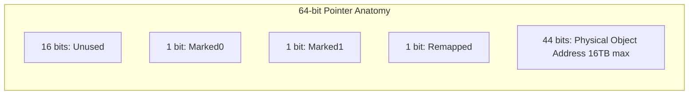

# ZGC Colored Pointers & JIT Load Barriers Architecture

The Z Garbage Collector achieves sub-millisecond maximum pause times by embedding heap metadata directly into pointer address bits and repairing stale object references concurrently via load barriers.

---

## 1. Concurrent Load Barrier Protocol

When user code dereferences an object pointer (`obj.field`), a JIT-compiled load barrier tests the colored status bit:

* **Good Color:** Pointer is up to date; dereference proceeds without intervention (~2-3 CPU instructions).
* **Bad Color:** Object has moved during concurrent evacuation; slow path queries the forwarding table, repairs the reference, and updates the pointer in place.
