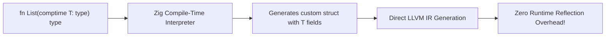

# Modern Systems Languages: Zig Comptime Architecture

Zig replaces C preprocessor macros and C++ template bloat with `comptime`: executing standard Zig code at compile-time to generate types and functions.

---

## 1. Safety Advantage
No separate template language to learn: compile-time code uses the identical syntax, type system, and memory rules as runtime code.
