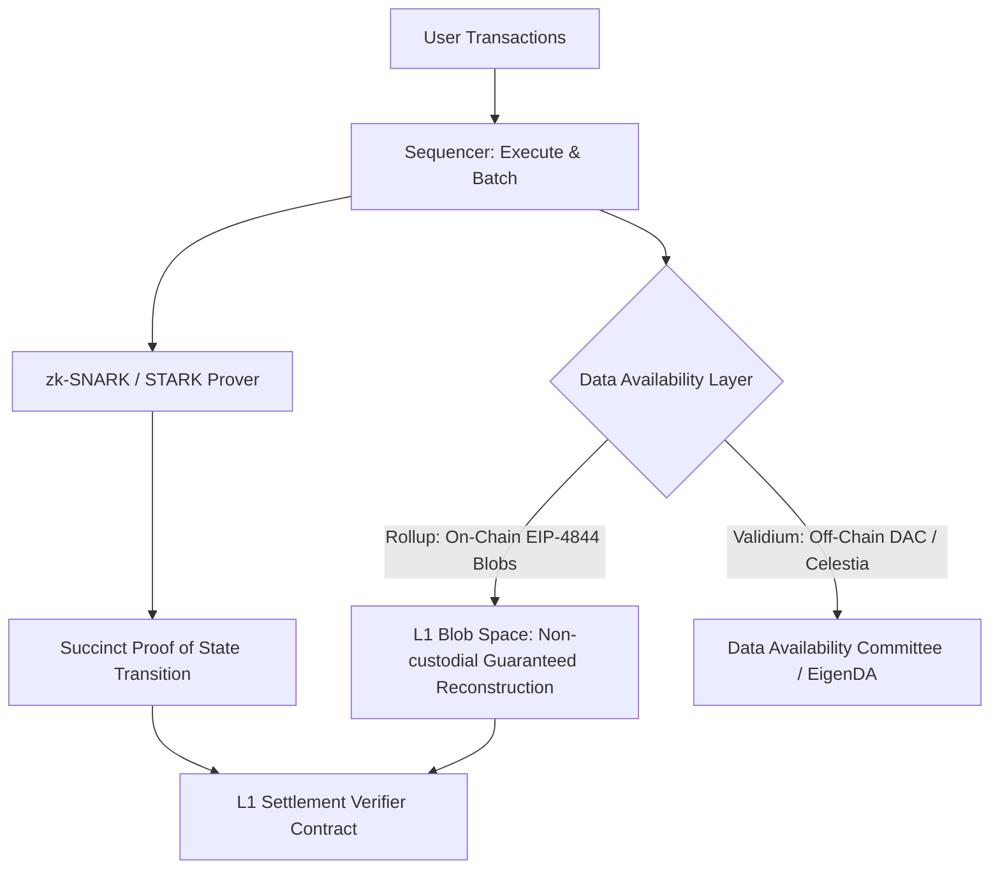

# zk-Rollups & Data Availability Architectures

zk-Rollups execute transactions off-chain and post validity proofs and compressed state differences to a layer-1 settlement contract to guarantee liveness and non-custodial asset recovery.

---

## 1. Rollup vs Validium vs Volition

| Architecture | Proof System | Data Availability Location | Security Guarantee |
|---|---|---|---|
| **zk-Rollup** | Validity Proof (zk-SNARK/STARK). | L1 CallData / EIP-4844 Blobs. | Full L1 security inheritance; immune to operator freeze. |
| **Validium** | Validity Proof. | Off-chain DAC / Alternative DA layer. | High throughput ($10^4+$ TPS); vulnerable to data withholding attacks. |
| **Volition** | Validity Proof. | Per-transaction user choice (L1 or Off-Chain). | Hybrid balance between cost and asset value. |
