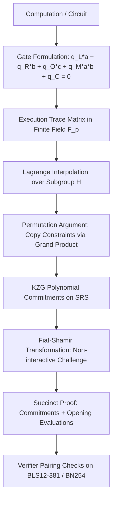

# zk-SNARKs & Plonk Arithmetization Architecture

Plonk (Permutations over Lagrange-bases for Oecumenical Non-interactive arguments of Knowledge) transforms computation into polynomial identity constraints over roots of unity in a cryptographic pairing-friendly elliptic curve field.

---

## 1. Plonk Gate Equation

A standard Plonk gate constrains three wires (Left $a_i$, Right $b_i$, Output $c_i$) using five selector polynomials:

$$q_{L,i} \cdot a_i + q_{R,i} \cdot b_i + q_{O,i} \cdot c_i + q_{M,i} \cdot (a_i \cdot b_i) + q_{C,i} = 0$$

| Selector Values | Operation | Equation Evaluated |
|---|---|---|
| $q_L=1, q_R=1, q_O=-1, q_M=0, q_C=0$ | Addition Gate | $a_i + b_i - c_i = 0 \implies c_i = a_i + b_i$ |
| $q_L=0, q_R=0, q_O=-1, q_M=1, q_C=0$ | Multiplication Gate | $a_i \cdot b_i - c_i = 0 \implies c_i = a_i \cdot b_i$ |
| $q_L=1, q_R=0, q_O=0, q_M=0, q_C=-K$ | Constant Assignment | $a_i - K = 0 \implies a_i = K$ |
| $q_L=-1, q_R=0, q_O=0, q_M=1, q_C=0$ | Boolean Assertion | $a_i^2 - a_i = 0 \implies a_i \in \{0, 1\}$ |

---

## 2. Copy Constraints & Grand Product Argument

1. Wire values across disparate gates must match if they represent identical variables.
2. Plonk encodes wire permutations via permutation cycles $\sigma: [3n] 	o [3n]$.
3. Constructs accumulator polynomial $Z(X)$ tracking progressive products:
   $$Z(\omega \cdot X) = Z(X) \cdot rac{(a(X) + eta X + \gamma)(b(X) + eta k_1 X + \gamma)(c(X) + eta k_2 X + \gamma)}{(a(X) + eta S_{\sigma 1}(X) + \gamma)(b(X) + eta S_{\sigma 2}(X) + \gamma)(c(X) + eta S_{\sigma 3}(X) + \gamma)}$$
4. Enforces $Z(\omega^0) = 1$ and boundary conditions via vanishing polynomial $Z_H(X) = X^n - 1$.
