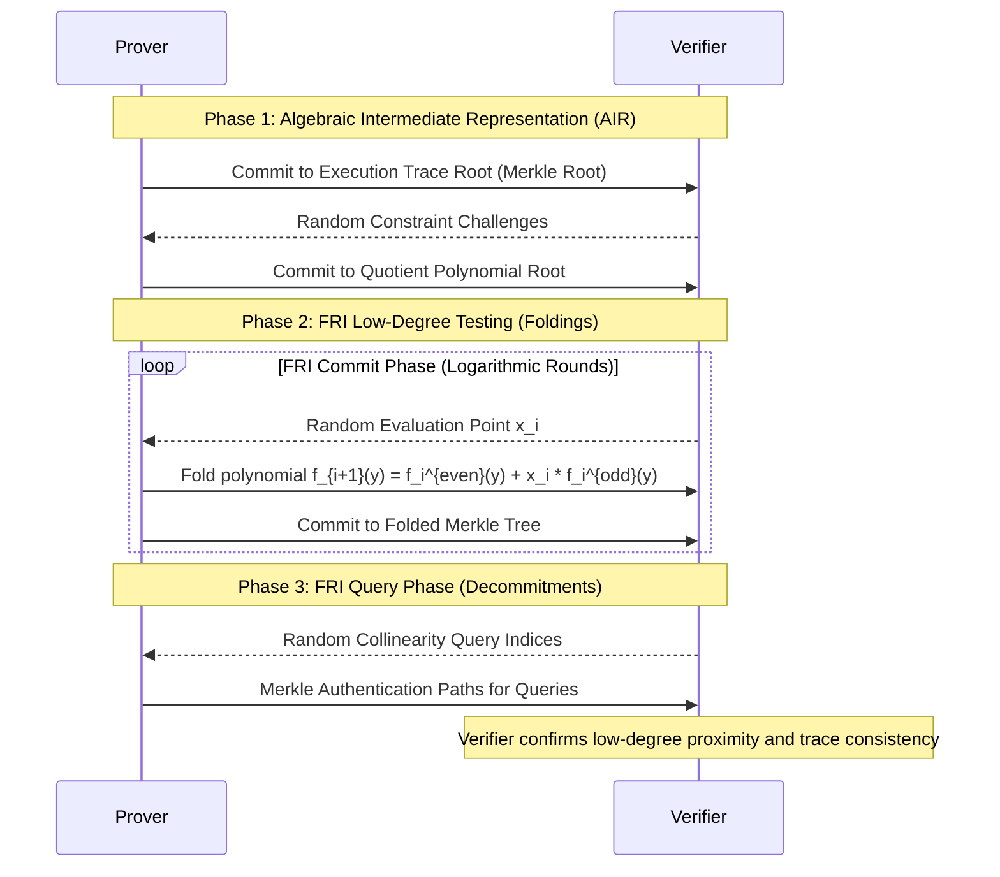

# zk-STARKs & Fast Reed-Solomon IOP of Proximity (FRI)

zk-STARKs (Zero-Knowledge Scalable Transparent Arguments of Knowledge) eliminate trusted setup ceremonies by relying on cryptographic collision-resistant hash functions and interactive oracle proofs of low-degree proximity over Reed-Solomon codewords.

---

## 1. SNARKs vs STARKs Architectural Trade-offs

| Parameter | zk-SNARK (Plonk / Groth16) | zk-STARK |
|---|---|---|
| **Setup Assumption** | Trusted Setup (SRS / Powers of Tau). | Transparent (Only public hash functions, zero toxic waste). |
| **Cryptographic Hardness** | Discrete Logarithm / Bilinear Pairings. | Collision-Resistant Hashes (SHA-256, Blake3, Rescue, Poseidon). |
| **Quantum Resistance** | Broken by Shor's Algorithm. | Post-Quantum Secure (Lattice / Hash based). |
| **Proof Size** | 200–800 bytes (constant). | 40–150 KB (poly-logarithmic). |
| **Prover Complexity** | High memory usage for elliptic curve MSM. | Quasi-linear $O(N \log N)$ FFT / NTT trace arithmetic. |
| **Verification Speed** | Constant pairing checks (~3–10 ms). | Logarithmic Merkle path evaluations (~5–20 ms). |

---

## 2. FRI Folding Mechanics

At round $i$, with polynomial $P_i(x)$ of degree $< d$:
1. Decompose into even and odd degree components:
   $$P_i(x) = P_i^{even}(x^2) + x \cdot P_i^{odd}(x^2)$$
2. Given verifier challenge $lpha \in \mathbb{F}$:
   $$P_{i+1}(y) = P_i^{even}(y) + lpha \cdot P_i^{odd}(y)$$
3. The degree drops by half: $\deg(P_{i+1}) < rac{d}{2}$.
4. Terminates when the folded polynomial is constant (degree 0), verified directly by sending the scalar.
