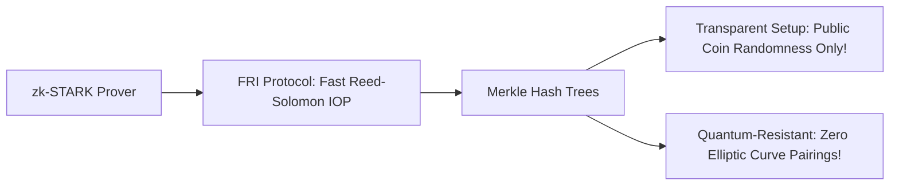

# Zero-Knowledge Architecture: zk-STARKs vs zk-SNARKs

zk-STARKs (Scalable Transparent Arguments of Knowledge) eliminate trusted setup ceremonies and post-quantum vulnerability by relying entirely on collision-resistant hash functions and FRI.

---

## 1. Tradeoffs
- **Pros of STARKs:** No toxic waste ceremony; post-quantum safe; faster proof generation for massive computations.
- **Cons of STARKs:** Proof sizes are substantially larger (40KB - 100KB vs 128 bytes for Groth16).
