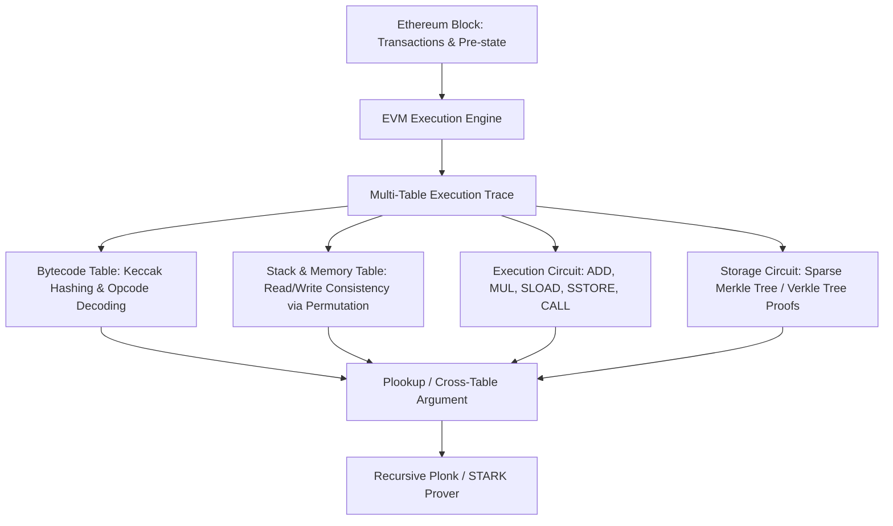

# zkEVM State Transition Circuit Architecture

A zkEVM proves the valid execution of Ethereum Virtual Machine bytecode transitions within zero-knowledge circuits, reconciling non-algebraic 256-bit word architectures with pairing-friendly finite fields.

---

## 1. Architectural Types (Vitalik Classification)

| Type | Architecture | EVM Compatibility | Proof Generation Speed |
|---|---|---|---|
| **Type 1** | Fully Ethereum-equivalent (Consensus & Hash level). | Identical (Runs existing clients unchanged). | Slowest (~hours/proof). |
| **Type 2** | EVM-equivalent (Modifies block structure & state trees). | 100% bytecode compatible. | Fast (~minutes). |
| **Type 3** | Almost EVM-equivalent (Alters gas costs, drops precompiles). | Minor edge-case rewrites. | Faster (~seconds). |
| **Type 4** | High-level language equivalent (Compiles Solidity to zk-friendly ISA). | Contract source compatible. | Fastest (~seconds). |
